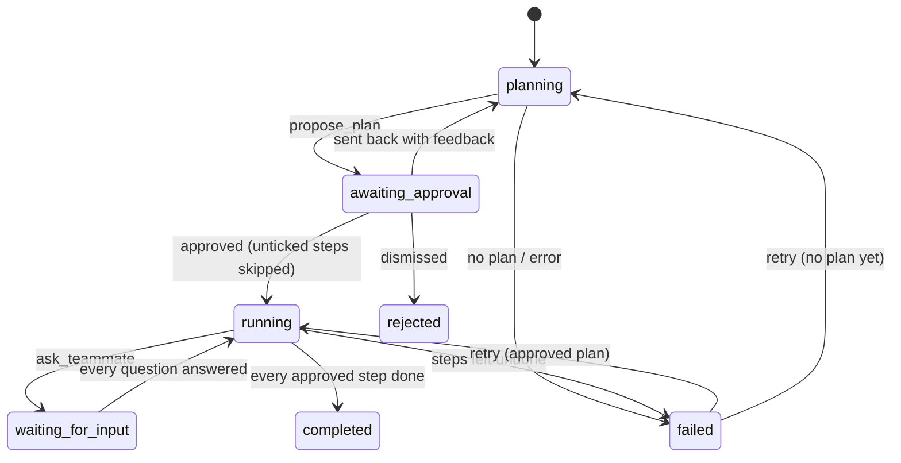

# Agent Runs, Human Approval, and Automations

The three AI agents do real work in the app: they write deliverables, break work into owned tasks, ask teammates for missing facts, measure gaps from uploaded data, and set up automations. A person approves every plan before an agent changes anything.

| Agent | Type | Owns |
|---|---|---|
| Charlie, GTM Strategist | `gtm_strategist` (one assessment) | Diagnosis, priorities, plans, and the resource library |
| Milo, Insights | `insights` (workspace) | Recent activity, pending reviews, overdue tasks, and score trends across assessments |
| Remy, GTM Engineer | `gtm_engineer` (workspace) | Systems design, data and measurements, the tool stack, and automations |

Nora (portfolio trends) and Theo (resource library) were merged into Milo and Charlie on 2026-10-28 (`RETIRED_AGENTS` in `gtm/agent_runtime.py`). Their past comments, documents, and chat turns still show their names; anything still routed to them goes to the successor. Specialist tools are grouped by capability and assigned in `DOMAIN_CAPABILITIES` (`gtm/workspace_agent_chat.py`).

## The run lifecycle (`gtm/agent_runs.py`)

An `AgentRun` (`gtm/models_agent_runs.py`) is one piece of agent work. It is started by **Complete with AI** on a task, by an agent routing a task to another agent (`assign_task_to_agent`), or from chat (`start_multi_step_work`).



1. **Planning.** The agent gets only its read tools, plus `propose_plan`. Each step has a `kind` from `STEP_KINDS`. A kind is only offered when it can actually work: CRM steps need a connected CRM, and automations need a workspace.
2. **Approval.** The run panel (`dashboard/views/agent_runs.py`, which opens from the task card or a notification link `/dashboard/tasks/?run=<id>`) shows the plan. People with `can_approve_agent_runs` (admin, manager, consultant; or the owner of a personal assessment) can untick steps, approve, send the plan back with feedback, or dismiss it.
3. **Execution.** Every write tool is wrapped by `_gate`. It refuses any call that has no pending approved step of its kind. A step only counts as done when the tool reports a real object it created (`agent_actions._record_outcome`). A tool call that changes nothing leaves the step to do.
4. **Questions.** `ask_teammate` pauses the run in `waiting_for_input` and notifies the teammate. Answering from the panel resumes the run. The context for the resumed turn is rebuilt from the plan, step results and answers, not from Gemini chat history.
5. **Write-back.** A task moves to Done only when every approved step really happened. Otherwise it stays In progress, with a comment listing what's left.

### Step kinds

| Kind | Tools | Notes |
|---|---|---|
| `create_document` | `create_document`, `edit_document` | The real deliverable, not a template |
| `create_subtasks` | `create_subtasks` | Owners (teammate or agent) and due dates; linked via `ActionItem.parent` |
| `assign_task` | `assign_task`, `assign_task_to_agent` | Routing to an agent starts that agent's own approved run |
| `ask_teammate` | `ask_teammate` | Pauses the run |
| `notify_teammate`, `comment` | `notify_teammate`, `comment_on_task` | |
| `recommend_resource` | `recommend_resource` | |
| `flag_gap` | `escalate_gap` | `current` must be measured or 0, never estimated |
| `propose_measurement` | `propose_measurement` | See below |
| `create_automation` | `create_automation` | See below |
| `crm_update` | `log_insight_to_crm`, `create_crm_follow_up_task` | Only when HubSpot is connected |

## Measurements from uploaded data (`gtm/data_tools.py`)

Agents never do arithmetic themselves. `profile_data_file` and `compute_metric_from_file` run fixed operations (count, ratio, sum, mean, median, min, max, with column filters) over the real rows of uploaded CSV/XLSX evidence, read through Django storage.

`propose_measurement` recomputes the value from the file; the model can't pass a number in. It creates a pending `GapMeasurementProposal`. Only a person confirming it creates a `GapMetricMeasurement(source='evidence')`, through `record_gap_measurement`, which applies the same closure rule as a manual check-in. An AI-computed value never moves or closes a gap on its own.

## Automations (`gtm/automations.py`)

An `Automation` creates a task or notifies people. It fires on a schedule, while a gap metric is off target, or when tasks are overdue. Rules are deterministic Python with no AI calls or credits. Agents create them only through an approved `create_automation` step. People pause or delete them from **Automations** on the Tasks board.

`python manage.py run_automations` runs every due automation. Each automation is claimed under a lock and its `next_run_at` is advanced before it acts, so overlapping runs never act twice. The same command also fails agent runs whose worker died (stuck in planning or running for over 15 minutes with no lock), so they can be retried.

### One-time scheduler setup (production)

`cloudbuild.yaml` updates the job's image on every deploy once the job exists. Create the job and its hourly trigger once:

```bash
gcloud run jobs create gtm-automations \
  --region=us-west1 \
  --image=gcr.io/forge-497716/gtm-validator:<SHORT_SHA> \
  --service-account=forge-177@forge-497716.iam.gserviceaccount.com \
  --set-cloudsql-instances=forge-497716:us-west1:gtm-db-v2 \
  --set-env-vars=GCP_PROJECT_ID=forge-497716,ENVIRONMENT=production,DEBUG=False,GCS_BUCKET_NAME=forge-497716-gtm-media,SITE_BASE_URL=https://forge.funti3r.xyz \
  --set-secrets=DB_PASSWORD=DB_PASSWORD:latest,DJANGO_SECRET_KEY=DJANGO_SECRET_KEY:latest,EMAIL_HOST_USER=EMAIL_HOST_USER:latest,EMAIL_HOST_PASSWORD=EMAIL_HOST_PASSWORD:latest \
  --memory=4Gi --cpu=2 --task-timeout=900 --max-retries=0 \
  --command=python --args=manage.py,run_automations

gcloud scheduler jobs create http gtm-automations-hourly \
  --location=us-west1 \
  --schedule="0 * * * *" \
  --http-method=POST \
  --uri="https://run.googleapis.com/v2/projects/forge-497716/locations/us-west1/jobs/gtm-automations:run" \
  --oauth-service-account-email=forge-177@forge-497716.iam.gserviceaccount.com
```

## Remy, the GTM Engineer

Remy (`agent_type="gtm_engineer"`, a workspace agent) designs and instruments the systems that run the GTM motion: lead scoring, routing and SLAs, funnel stages, the metrics behind each gap, the tool stack, and automations.

Like every workspace agent, he works from the workspace's latest completed assessment (`get_gtm_assessment_data`, `get_gtm_diagnosis`). His domain tools add the data tools, `get_tool_recommendations` and `list_automations`.

The assessment tool lists exactly what the assessment records and says "not stated" for the rest. Agents are instructed never to present an assumption as something the company said.
