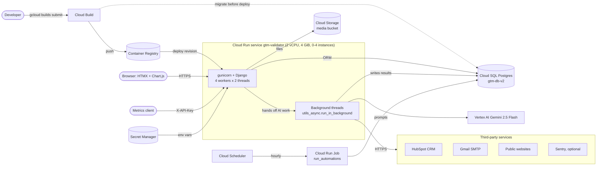
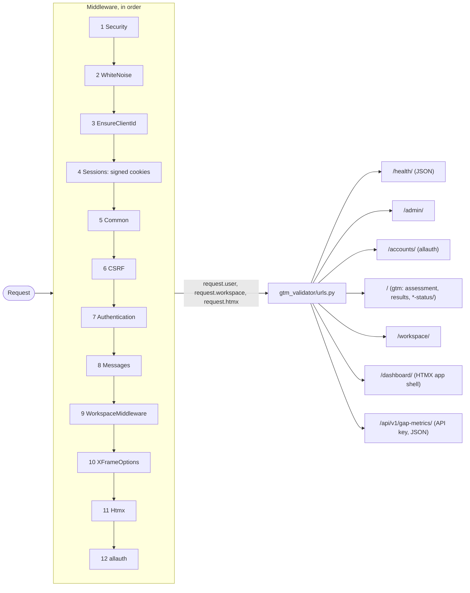
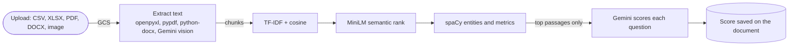
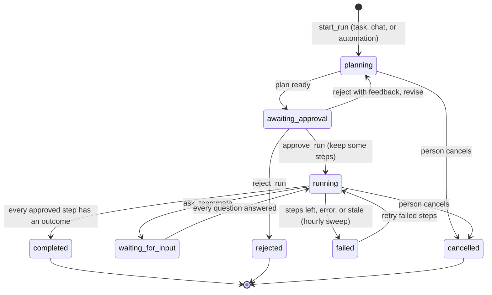
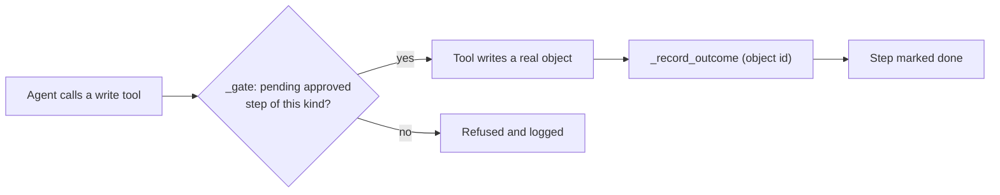
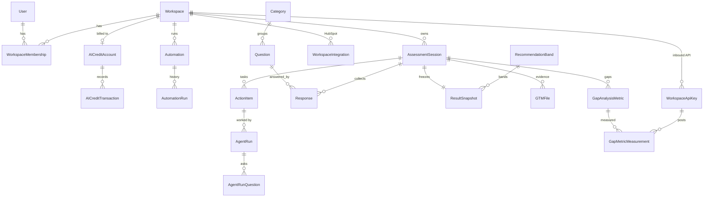

# System Design

How GTM Validator is built and how its parts connect. Every claim below was traced from the code on master in November 2026. If you change something shown here, update the diagram in the same PR.

The short version: one Django monolith runs on Cloud Run, backed by Cloud SQL Postgres and Cloud Storage. Scoring is deterministic Python. Gemini writes prose about the scores in background threads, and the browser polls for the result with HTMX. Agents do real work only through runs that a person has approved, and the code enforces that approval.

---

## 1. Deployment



| Decision | Why |
|---|---|
| `--no-cpu-throttling` | Background threads keep working after the response returns. With throttling on, Cloud Run starves them and the browser polls forever. |
| 4 GiB memory | spaCy, sentence-transformers and scikit-learn are loaded on top of four gunicorn workers. 2 GiB runs out of memory. The models load lazily on first document analysis, not at boot. |
| `min-instances=0` | Cost. The first request after about 15 idle minutes pays a cold start, which `--cpu-boost` shortens. |
| Signed-cookie sessions | No server-side session store, so instances share nothing but the database. Keep session data small. |
| Migrate inside Cloud Build | `migrate` runs through the Cloud SQL proxy before `run deploy`. If it fails, the new revision never takes traffic. |
| One image, two runtimes | The hourly `gtm-automations` job uses the service's image, and every deploy updates both. |

Local dev replaces Postgres with SQLite and GCS with local disk, and sends email to the console. See `cloudbuild.yaml`, `docker-entrypoint.sh` and `gtm_validator/settings.py`.

---

## 2. Request path



- **EnsureClientId** (`gtm/middleware.py`) gives anonymous visitors a cookie id, so they can start and resume an assessment before logging in.
- **WorkspaceMiddleware** (`gtm/middleware_workspace.py`) attaches the active workspace and redirects non-members. It must come after Authentication and Messages. Views then guard themselves with `@workspace_permission_required('can_...')` from `gtm/decorators.py`.
- Views check `request.htmx` and return a partial instead of the full template. The polling partials use `hx-trigger="every 3s"` up to `every 6s`.
- Session access goes through `safe_get_session_or_403` (`gtm/services.py`), which allows the session's owner, a member of its workspace, or the anonymous visitor whose client id matches.
- Signup is wrapped in `transaction.atomic`, so a failed signup also rolls back the invite-code redemption.

---

## 3. Code map

The modules, grouped by layer. Arrows mean "imports", taken from the real import statements.

```mermaid
flowchart TB
    subgraph entry[Entry points]
        views[gtm/views, dashboard/views]
        wsviews[views_workspace]
        inbound[inbound_api]
        cmd[run_automations command]
    end
    subgraph domain[Domain logic, no AI]
        scoring[scoring_engine]
        compare[score_comparison]
        services[services]
        datatools[data_tools]
        automations[automations]
    end
    subgraph ai[AI layer]
        aisvc[ai_services]
        auditor[ai_auditor]
        analyzers[category_analyzer, delivery_analyzer]
        chat[ai_chat, team_chat]
        runtime[agent_runtime]
        runs[agent_runs, agent_actions]
        credits[ai_credits]
    end
    subgraph io[Ingestion and output]
        docproc[document_processors]
        webtools[web_tools]
        hubspot[integrations.hubspot_client]
        out[utils_pdf, utils_docx, utils_email]
    end
    subgraph state[State and clients]
        models[(Django models)]
        locks[(utils_locks: AIGenerationLock)]
        gemini[Gemini client]
    end

    views --> scoring & services & aisvc & auditor & analyzers & chat & runs
    cmd --> automations
    services --> aisvc & credits
    compare --> scoring
    automations --> runs & runtime
    aisvc --> scoring & credits & runtime & locks & gemini
    auditor & analyzers & docproc --> aisvc
    chat --> aisvc & runs & runtime & webtools & auditor
    runs --> runtime & chat & automations & datatools & webtools & hubspot
    runtime --> aisvc
    credits --> out
```



Things to know:

- `scoring_engine` imports nothing from the app. That is what keeps Layer 1 deterministic. Keep it that way.
- `ai_services` is the hub. Every AI feature goes through its client, its locks and quota cooldown, and `ai_credits`. Reuse `_acquire_lock`, `_quota_cooldown_active`, `_clean_json_response` and `_strip_imperative_sentences` rather than writing new ones.
- The NLP relevance filter lives in `gtm/delivery_analyzer.py`, and `category_analyzer` reuses it. `dashboard/parsers.py` parses chat task commands, not files.
- `gtm/views.py` and `dashboard/views.py` are now packages (`gtm/views/`, `dashboard/views/`).

---

## 4. Scoring and AI: the two-layer pipeline

```mermaid
sequenceDiagram
    participant B as Browser
    participant V as Django view
    participant S as scoring_engine
    participant DB as Postgres
    participant T as Background thread
    participant G as Gemini

    B->>V: submit 18 answers (1-5)
    V->>S: weights, pillar scores, patterns
    S-->>V: overall 0-100, opportunities, named patterns
    V->>DB: save ResultSnapshot (frozen breakdown)
    V->>T: run_in_background(playbook, enrichment)
    V-->>B: results page with real scores, AI sections loading
    T->>DB: _acquire_lock + can_spend + quota cooldown check
    alt allowed
        T->>G: prompt with Layer 1 context only
        G-->>T: prose (JSON)
        T->>T: _clean_json_response, _strip_imperative_sentences
        T->>DB: save AI text, record_spend
    else cooldown, no credits, or quota error
        T->>DB: nothing written; pre-written root_cause / quick_win render
    end
    loop every 3-6 s
        B->>V: GET *-status/ (HTMX)
        V-->>B: partial, swapped in when ready
    end
```

- **Layer 1** (`gtm/scoring_engine.py`) decides every number: pillar weights, `QUESTION_META`, opportunity scores and named failure patterns such as ICP Undefined, Conversion Leak and Delivery Churn Risk. Its question weights must match `load_gtm_defaults.py`; `id_code` is the join key. The exact math is in [scoring_logic.md](scoring_logic.md).
- **Layer 2** (`gtm/ai_services.py`) writes company- and industry-specific prose about those numbers. It never makes its own diagnosis.
- **Snapshot pattern.** `ResultSnapshot` freezes the category breakdown, band and radar data when the assessment completes, so a later change to the questions never rewrites a past report.
- **Locks and the cooldown are stored in the database** (`AIGenerationLock` through `gtm/utils_locks.py`), not in Django's cache, so they hold across Cloud Run instances. A quota error sets a cooldown that pauses all Gemini calls.
- **Credits.** `can_spend` runs before a call and `record_spend` runs after it, charging tokens to the workspace's or user's `AICreditAccount` (1 credit = 1000 tokens).

### Evidence uploads



Only the most relevant passages reach Gemini, never the whole file. Separately, `ai_auditor.py` turns a 1-10 evidence score into a -3 to +3 score modifier for audited files. Details are in [document_processing.md](document_processing.md).

---

## 5. Agent runs

Agents (Charlie, Milo and Remy, defined in `gtm/agent_runtime.py`) plan with read-only tools. A person approves the plan, and then the code refuses any write that is not an approved step.





- `STEP_KINDS` (`gtm/agent_runs.py`) lists what a step may do. Adding a write tool means adding it to `STEP_KINDS` and calling `_record_outcome`. See [agent_runs.md](agent_runs.md).
- A step is done only when a tool reports a real object. A run whose approved steps did not all produce an outcome ends as `failed` and offers a retry.
- The hourly job fails runs idle for 15 minutes (`sweep_stale_runs`) unless their lock is still held.
- Data math goes through `gtm/data_tools.py`. AI-computed measurements become a `GapMeasurementProposal` that a person must confirm.
- Automations (`gtm/automations.py`) are deterministic rules. Triggers are a schedule, a gap metric off target, or overdue tasks. Actions are creating a task or notifying people. They use no AI and no credits.

---

## 6. Data model

The tables that carry the product (43 models in total; see [data_models.md](data_models.md)).



- **Workspace is the tenant boundary.** Access checks go through `WorkspaceMembership` methods.
- **Gaps close only on measured data or a human resolve**, never on task completion or an AI estimate.
- Each `WorkspaceIntegration` token is stored encrypted (`gtm/integrations/crypto.py`).
